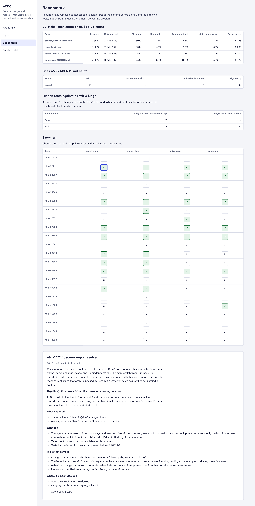
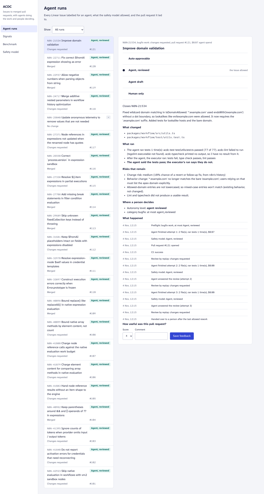
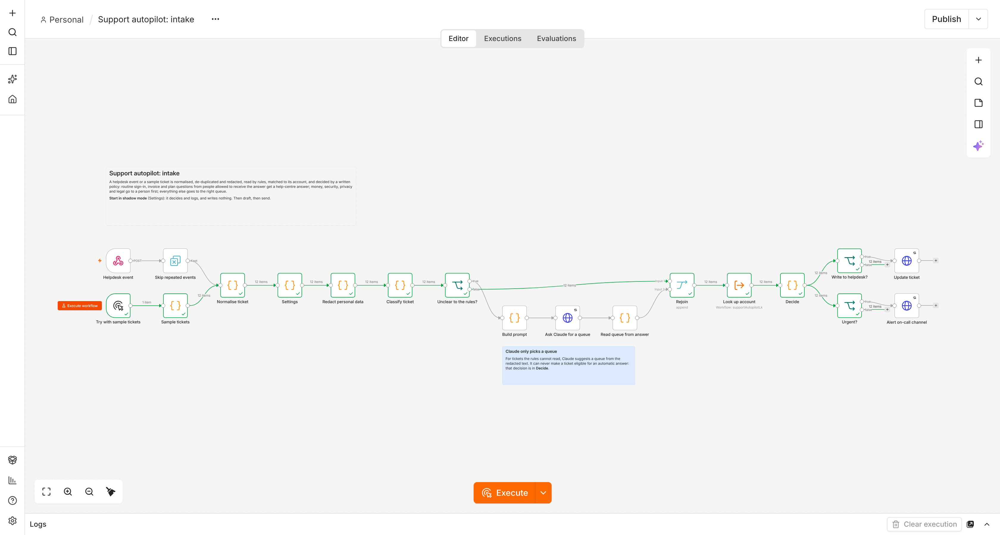

# agent-centric-dev-cycle

**Agents doing real work in n8n's monorepo, with people deciding.** This repository is the platform
side of an agent-centric development cycle (ACDC) for a large TypeScript monorepo, built and measured
on [n8n](https://github.com/n8n-io/n8n) itself:

- a **safety model** that decides which work an agent may attempt, what it must never touch and who
  must review, read from n8n's own OWNERS file and checked against n8n's merge gate on every file;
- a **change-risk model** trained on 10,589 changes n8n merged since November 2025, and a replay of
  automated approval in shadow mode on the two months it never saw;
- a **benchmark of real n8n fixes**: each agent starts at the commit before the fix, gets the issue,
  and is graded by the fix's own hidden tests, CI checks, the safety model and a review judge;
- a **loop service** that takes Linear issues through a sandboxed agent run to a pull request with
  evidence, answers review, and computes acceptance, CI, rework, cost and satisfaction from events;
- a **console** for the runs, the signals, the benchmark and the safety model.

`docs/PROPOSAL.md` is the proposal this work supports: what to build first, what to buy, what to
measure, and what would make us stop.

## Results

Every number here is generated (`reports/RESULTS.md`, `reports/*.json`) and the risk study is rerun in CI.

**The safety model, checked against n8n itself.** The OWNERS matcher agrees with n8n's own
`owners.mjs` on the owning team of all **33,261 files** in the repository and on the required
reviewers of all **3,219 changes** merged since September. Replayed on the **2,800 changes** n8n merged
in September and October 2026, it would have made 9% human-only (mostly CI and workflow files), 44%
drafts, 43% reviewed changes and **3.7% auto-approvable, of which none needed a revert or a follow-up
fix** (104 changes; 95% interval 0–3.6%). Drafts are where the risk is: 35% of them needed one.

**Change risk, on months the model never saw.** Trained on 7,369 changes up to August, tested on 2,800
later ones: AUC **0.77** against 0.60 for "small changes with tests first", calibration error 0.03.
If 20% of changes were approved without a person, **3.8% of those would have needed a fix, against
10.2%** with the size rule (30%: 6.1% against 12.4%). Without the file-history feature, which partly
measures the label's own noise, the AUC is 0.73.

**Agents on 22 real n8n fixes**, each setup once, $16.71 in agent spend including reruns:

| Setup | Resolved | 95% interval | Said done, wasn't | Cost per resolved |
|---|---:|---|---:|---:|
| Sonnet, with n8n's AGENTS.md | 9 of 22 | 23–61% | 59% | $0.35 |
| Sonnet, without it | 10 of 22 | 27–65% | 50% | $0.33 |
| Haiku, with AGENTS.md | 7 of 22 | 16–53% | 32% | **$0.07** |
| Opus, with AGENTS.md | 7 of 22 | 16–53% | 50% | $1.22 |



What that decides:

1. **n8n's AGENTS.md made no measurable difference on this package.** Same model, same tasks: one
   task was solved only without it, none only with it (sign test p = 1.0). It is written for the
   whole monorepo (pnpm, turbo, conventions); for single-package fixes it is context the agent pays
   for and does not use. Before writing more agent context, measure it per area the same way.
2. **A bigger model did not buy more fixes.** Opus solved as many tasks as Haiku at 18 times the cost
   per solved task; Sonnet solved two or three more. With 22 tasks the intervals overlap, so the
   decision is about price: default to the cheap model and escalate on failure, not the reverse.
3. **The issue is the bottleneck, not the agent.** The judge read every change next to the fix n8n
   merged: of the unresolved runs, **36 of 49 missed a case** the fix covered and the one-line issue
   did not state; 5 fixed the wrong cause; 4 were underspecified; 4 were valid fixes the tests
   rejected. Ten tasks were solved by no setup. The cheapest lever is the issue template: state the
   cases and a reproduction, which is also what makes the agentic path work for PMs and designers.
4. **"Tests pass" from an agent is not evidence.** Agents ran tests themselves in 86–100% of runs, and
   in **42 of the 55 runs that did not solve the issue** they still said their tests pass. PR evidence
   therefore shows what the executor ran, not what the agent said.
5. **Hidden tests and a reviewer disagree in 13 of 82 changes**: 9 failing changes a reviewer would
   accept, 4 passing ones a reviewer would send back. That is the share of the benchmark that needs a
   person before its numbers are used for a decision.



The runs screen above is the loop replaying the benchmark's real agent changes; the issue tracker,
code host and reviewers are stand-ins (review follows the grader), so its acceptance and rework
numbers describe the replay, not reviewers.


## How it works

```
Linear issue ──▶ preflight (category) ──▶ sandboxed agent run ──▶ executor checks ──▶ decide (change)
   label "agent"     security? human only     worktree, no network      tests, tsc,          forbidden: discard
                                              for tests, empty env,     n8n's oxlint         sensitive: draft + IAM
                                              allowlisted commands                           OWNERS required teams
                                                                                             size, change risk
                                                         ┌──────────────────────────────────────────┘
                                                         ▼
                                   pull request with evidence ──▶ review ──▶ rework (≤ 2) ──▶ merge or hand over
                                   what changed, what ran,         webhooks, deduplicated,
                                   what risk remains, who decides  every event append-only
```

- **The safety model only lowers** (`packages/core/src/policy.ts`, `config/safety.yaml`). The issue's
  category sets the ceiling; forbidden paths, sensitive paths, OWNERS required teams, size and the
  risk tier can only lower it. ADR 0001.
- **Change risk** (`packages/core/src/risk.ts`) is a logistic regression with readable weights; the
  label is a revert or a small follow-up fix within 7 days. ADR 0002.
- **The benchmark** (`packages/bench`) mines fix commits, validates each one fail-to-pass in the
  sandbox, runs Claude Code headless with least privilege, grades, writes PR evidence and asks a
  judge why runs failed. ADR 0003 and 0004.
- **The loop** (`packages/service`) is a Fastify service over PostgreSQL with signed, deduplicated
  Linear and GitHub webhooks; the executor is the benchmark's sandbox on the current branch.

## Run it

```sh
pnpm install
pnpm test && pnpm typecheck && pnpm lint                 # service tests need ACDC_TEST_DATABASE_URL
cd apps/console && pnpm test && pnpm e2e                 # Playwright with axe, against recorded API responses
```

With an n8n checkout (history since November 2025) in `N8N_REPO`, every number above is rebuilt by:

```sh
pnpm acdc history && pnpm acdc risk && pnpm acdc owners-check
pnpm acdc tasks && pnpm acdc run && pnpm acdc judge && pnpm acdc report
```

The service needs `ACDC_DATABASE_URL`, `N8N_REPO`, `LINEAR_API_KEY`, `LINEAR_WEBHOOK_SECRET`,
`GITHUB_TOKEN` and `GITHUB_WEBHOOK_SECRET`; nothing has a default. `pnpm --filter @acdc/service start`.

## Limits

- **One package.** Tasks come from `packages/workflow`, one of n8n's best-tested packages, so the
  hidden tests are strong. Results say nothing yet about the editor or nodes.
- **One sample per setup and task.** With 22 tasks a resolve rate is ±20 points; the paired
  comparison is the sensitive one. Agents vary between runs: an earlier Opus run on one task, rerun
  after a harness fix, solved it the first time and not the second.
- **The issue is the PR title.** Real Linear issues may say more or less; the judge's "missed a case"
  share is the measure of what a title leaves out.
- **Two dependency eras.** Today's install runs 9 tasks; 13 older ones run on an install from July
  2026. On older checkouts n8n's type-aware linter cannot run (its `tsgolint` binary is not in that
  era's install), so lint is checked on the 9 current tasks only and the evidence says so.
- **Grader fixes are on record.** The grader was corrected four times while the runs were in progress
  (`GRADER_VERSION` in `packages/bench/src/grade.ts`); every stored change was graded again from its
  recorded diff, and no resolved verdict changed. Three sessions ended without an answer (the CLI
  exited) and nine older-era runs had a broken type-check wrapper; both were rerun once, and their
  cost stays in the ledger and in the total.
- **The judge is a model.** It sees the merged fix, so it is told what "right" looks like; its
  verdicts are reported next to the tests, never instead of them.
- **The risk label is a proxy.** n8n almost never reverts (6 of 10,589), so "needed a fix" means a
  small follow-up fix to the same files within a week; busy files attract fixes for other reasons.
- **The loop has run against fakes**, not live Linear and GitHub: the adapters verify signatures and
  speak both APIs, and the executor is the benchmark's sandbox, but no real issue has gone through.

## Also built in n8n

The same rule carries into n8n itself: models read, rules decide, a person sees anything risky
first, and new behaviour starts in shadow mode. Below is the intake workflow from
[n8n-support-autopilot](https://github.com/manojrevenkar12-web/n8n-support-autopilot), a separate
project by the same author, after a run with its 12 sample tickets in a real n8n.



A helpdesk ticket is de-duplicated, redacted, read by rules and matched to its account, and a
written policy decides what happens. Routine sign-in, invoice and plan questions get an automatic
answer; money, security, privacy and legal go to a person first. For tickets the rules cannot read,
Claude only suggests a queue and can never make a ticket eligible for an automatic answer. The
workflows pass 20 of 20 end-to-end checks inside n8n 2.44.7.

## Layout

| Path | What |
|---|---|
| `packages/core` | globs and test-file rules (as n8n's CI has them), OWNERS, the safety model, the risk model |
| `packages/bench` | history and labels, risk study, task mining and validation, sandbox, agent runner, grader, judge, report, production executor |
| `packages/service` | PostgreSQL store, Linear and GitHub adapters, the loop, metrics, HTTP API, replay and fixture capture |
| `apps/console` | React 19 console, feature folders, Motion, Vitest and Playwright with axe |
| `config/` | safety.yaml, risk.yaml, bench.yaml, service.yaml, and the trained risk-model.json |
| `data/` | the labelled history (gzip), n8n's OWNERS, benchmark tasks and their validation |
| `reports/` | generated: risk.json, owners-check.json, bench.json, RESULTS.md, every benchmark run |
| `docs/` | PROPOSAL.md and the ADRs |

n8n is a trademark of n8n GmbH. This is an independent project; `data/n8n/OWNERS` is a copy of n8n's
file under its Sustainable Use License, used to test that ownership is read the way n8n reads it.
